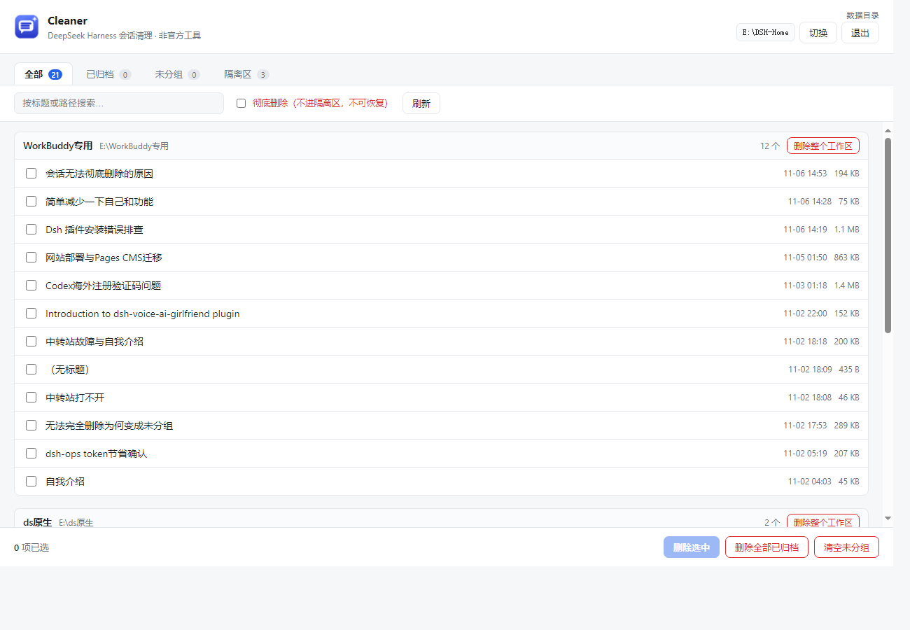

<div align="center">


# dsh-cleaner

**Permanently delete DeepSeek Harness sessions and workspaces.**
The official client only lets you archive — this tool actually removes them.

[](#download)
[](#download)
[](LICENSE)

[中文说明](README.zh-CN.md) · [Download](#download) · [Usage](#usage) · [FAQ](#faq)

</div>



## Why this exists

DeepSeek Harness ships with **no delete button**. The right-click menu on a session only offers *Fork*, *Archive*, *Unarchive*, *Pin* and *Copy Session ID*.

Archive does not free anything:

- **Archived sessions still occupy disk.** They are only hidden from the list. The official wording is *"Archived conversations are temporarily unavailable, please unarchive to view."*
- **Deleting a workspace does not delete its sessions.** They are detached and reappear under **Ungrouped** — with no way to remove them from there, because there is still no delete action.
- **There is no batch operation.** Cleaning 40 sessions means 40 right-clicks.

The server-side API exposes only `archive` / `unarchive`. No `delete` exists, so no plugin can add one. This tool works around that by editing the local store directly — carefully, with a trash folder and an index backup on every run.

## Features

| | |
|---|---|
| **See everything** | Every session on disk, grouped by workspace, badged `Archived` / `Orphaned` / `Pinned` |
| **Real deletion** | Moves the session directory out and detaches it from the index — the row is gone after restart |
| **Batch actions** | Delete selection · Delete all archived · Clear all ungrouped · Delete whole workspace |
| **Trash, not damage** | Default mode moves to `trash/`, restorable from the UI with one click |
| **Index backup** | `workspace.json` is copied before every write — recoverable even if something goes wrong |
| **Refuses to race** | Detects a running client and refuses to touch anything (the client would overwrite the index from memory) |
| **Tiny** | 7 MB single binary, no runtime, no installer |

## Download

Grab the file for your platform from [Releases](https://github.com/hhhhhhhush/dsh-cleaner/releases/latest):

| Platform | File | Notes |
|---|---|---|
| Windows 10/11 | `dsh-cleaner-windows-amd64.exe` | Double-click. No console window. |
| macOS (Intel / Apple Silicon) | `dsh-cleaner-darwin-*` | `chmod +x` then run |
| Linux | `dsh-cleaner-linux-amd64` | `chmod +x` then run |

> No Go, Node or Python needed. The UI opens in an app-mode window using the Chromium browser already on your system (Edge on Windows, Chrome on macOS). With no Chromium available it falls back to your default browser.

## Usage

1. **Quit DeepSeek Harness completely** — close the window *and* the tray icon. The tool refuses to run otherwise.
2. Launch `dsh-cleaner`. A window opens with every session listed.
3. Tick the sessions you want gone, or use a batch button at the bottom.
4. Reopen DeepSeek Harness — the sessions are gone.

Deleted sessions land in `<DSH_HOME>/trash/dsh-cleaner-<timestamp>/` and are restorable from the **Trash** tab. Tick *Permanently delete* to skip the trash entirely.

## Where your data lives

The tool finds `DSH_HOME` the same way the official client does, in this order:

1. `--home` flag
2. `$DSH_HOME` environment variable
3. `~/.qurwork-desktop-dsh/.dsh` (desktop client default)
4. `~/.dsh` (official default)
5. Drive-root scan (`X:\DSH-Home`, `X:\dsh-home`, `X:\.dsh`)

If more than one directory exists, use the **Switch** button in the top-right — it lists every candidate with its session count so you can pick the right one. Choosing wrong does no damage; it just shows the wrong list.

Inside that root:

```
<DSH_HOME>/
├── sessions/<workspace>/session-<uuid>/session.v4.jsonl.zstd   # conversation body
└── storages/workspace.json                                      # sidebar index
```

## CLI

The same binary also works headless:

```bash
dsh-cleaner --list                        # list every session
dsh-cleaner --delete-archived             # remove all archived sessions
dsh-cleaner --delete-orphan               # clear ungrouped sessions
dsh-cleaner --delete-workspace <id>       # remove a whole workspace
dsh-cleaner --list --home "D:\my-dsh"     # point at a specific data dir
```

Add `--hard` to skip the trash folder. Everything above is also available in the GUI.

## Safety

This tool edits files the official client owns, so it is built to fail softly:

- **Refuses while the client runs.** A running client holds the index in memory and will overwrite your changes. Rather than silently losing the edit, the tool stops.
- **Trash by default.** Nothing is erased until you empty the trash.
- **Index backup every write.** `<DSH_HOME>/backup-dsh-cleaner/workspace-<time>.json`.
- **Atomic writes.** The index is written to a temp file and renamed, so a crash cannot leave it half-written.
- **Localhost only.** The UI server binds `127.0.0.1` on a random port with a one-time token, and rejects requests whose `Host` header is not localhost — including the HTML entry point, so DNS rebinding cannot read the UI.
- **Writes are serialized.** The index is read-modify-write, so concurrent requests are queued; two deletions in the same second get separate trash batches instead of overwriting each other's manifest.
- **Trash paths are validated.** Restore/empty requests are rejected unless the target is a `trash/dsh-cleaner-*` directory inside the detected data root, so the API cannot be turned into an arbitrary-delete primitive.
- **Index and disk stay in sync.** A session is only detached from the index if its directory was actually moved or removed; a failed move never leaves a invisible-but-present session behind.
- **Unknown fields preserved.** The index is handled as a generic tree, so fields added by future client versions survive a round-trip.

## FAQ

**Does it delete anything in the cloud?**
No. It only touches local files. If DeepSeek later adds cloud sync for sessions, locally deleted ones may come back — verify with a non-critical session first. As of the tested build, deletion is local and permanent, verified by restarting the client.

**Is the conversation content uploaded anywhere?**
No network calls leave your machine. The tool has no telemetry and no update check.

**Will this break after a client update?**
Possibly. It depends on the on-disk format (`session.v4.jsonl.zstd`, `storages/workspace.json`). If the format changes, the tool reports an error instead of guessing. Issues and PRs are welcome.

**Why not a plugin?**
DSH plugins can only call the server API, which has `archive` but no `delete`. A plugin cannot add a delete button that works.

**Why is it so small?**
It is a Go binary with the UI embedded, reusing the browser already installed for rendering. No Chromium is bundled.

## Disclaimer

Unofficial tool. Not affiliated with DeepSeek. It modifies files owned by DeepSeek Harness; archived/trashed data of your own is your responsibility. Back up `<DSH_HOME>` before first use if the sessions matter to you.

## Development

```bash
git clone https://github.com/hhhhhhhush/dsh-cleaner
cd dsh-cleaner
go test ./...                                                    # delete, restore, trash guard, index round-trip
go build -ldflags "-H windowsgui -s -w" -o dsh-cleaner.exe .      # Windows
go build -o dsh-cleaner .                                        # macOS / Linux
```

Cross-compile all targets:

```bash
./build.sh
```

The icon is drawn by code, not drawn in a design tool — `tools/mkicon` renders every size (16→256) directly with the standard library, 4× supersampled for anti-aliasing, and writes a multi-size `.ico` plus the PNG used by the window and the web UI:

```bash
go run ./tools/mkicon      # → assets/icon.ico, assets/icon.png, web/favicon.png
```

To change the colours, edit the four variables at the top of `tools/mkicon/main.go` and re-run. Windows resource embedding (icon + file properties) uses [go-winres](https://github.com/tc-hib/go-winres):

```bash
go install github.com/tc-hib/go-winres@latest
go-winres make --arch amd64,386,arm64 --in winres/winres.json
```

The generated `rsrc_windows_*.syso` files are committed, so a plain `go build` produces an iconed executable without extra tooling.

Layout:

| Path | Responsibility |
|---|---|
| `main.go` | Entry point, flags, window launch, idle exit |
| `internal/config/` | Constants, `DSH_HOME` detection, remembered choice |
| `internal/store/` | Read sessions, index read/write, delete, trash, restore |
| `internal/server/` | Local HTTP API, token guard, embedded UI assets |
| `internal/launcher/` | Opens the app-mode window per platform |
| `internal/console/` | Attaches a console when started from a terminal |
| `internal/server/web/` | UI (one HTML + CSS + JS, shared by window and CLI) |
| `tools/mkicon/` | Generates the icon (all sizes) from code |
| `winres/` | Windows icon + version-info resource definition |
| `assets/` | Generated icon files |

## License

MIT
