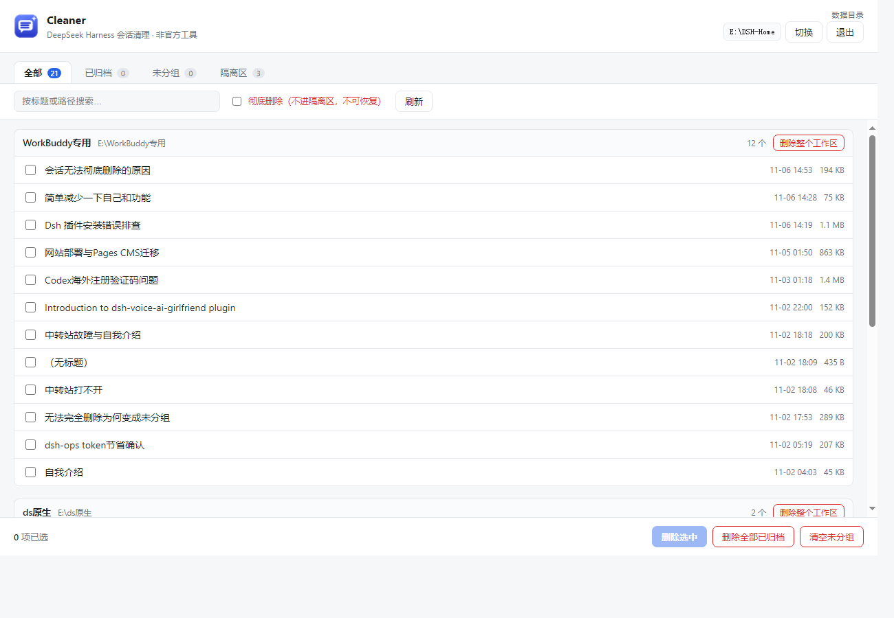

<div align="center">


# dsh-cleaner

**真正删除 DeepSeek Harness 的会话与工作区。**
官方客户端只能归档，这个工具能真的删掉。

[](#下载)
[](#下载)
[](LICENSE)

[English](README.md) · [下载](#下载) · [使用](#使用) · [常见问题](#常见问题)

</div>



## 为什么需要它

DeepSeek Harness **没有删除功能**。会话右键菜单只有五项：分叉、归档、取消归档、置顶、复制 Session ID。

而归档并不能真正清掉任何东西：

- **归档的会话照样占磁盘**。它只是从列表里隐藏，官方原文是「已归档对话暂时无法查看，请取消归档后查看」。
- **删除工作区不会删除里面的会话**。它们只会被「解绑」，全部跑到**未分组**下面，而那里同样没有删除入口——所以你永远清不掉。
- **没有批量操作**。清 40 个会话，就得点 40 次右键。

服务端接口只有 `archive` / `unarchive`，**根本没有 delete**，所以任何插件都不可能变出删除按钮。这个工具的做法是直接操作本地存储：每次改动都先进回收站、先备份索引，出问题能退回去。

## 功能

| | |
|---|---|
| **看得清** | 列出磁盘上全部会话，按工作区分组，标出`已归档`/`原工作区已删`/`置顶` |
| **真删除** | 把会话目录移走并从索引里摘除，重启客户端后列表里彻底消失 |
| **批量操作** | 删除选中 · 删除全部已归档 · 清空未分组 · 删除整个工作区 |
| **有后悔药** | 默认先进隔离区，界面上点一下就还原 |
| **自动备份** | 每次写索引前备份 `workspace.json` |
| **不会白删** | 检测到客户端在运行就拒绝执行（否则会被内存数据覆盖） |
| **体积小** | 7 MB 单文件，不依赖任何运行时，不用安装 |

## 下载

到 [Releases](https://github.com/hhhhhhhush/dsh-cleaner/releases/latest) 下载对应平台的文件：

| 平台 | 文件 | 说明 |
|---|---|---|
| Windows 10/11 | `dsh-cleaner-windows-amd64.exe` | 双击即用，不弹黑框 |
| macOS（Intel / Apple Silicon） | `dsh-cleaner-darwin-*` | `chmod +x` 后运行 |
| Linux | `dsh-cleaner-linux-amd64` | `chmod +x` 后运行 |

> 不需要装 Go、Node 或 Python。界面用系统已有的 Chromium 浏览器以「应用模式」打开（Windows 用 Edge，macOS 用 Chrome），没有 Chromium 时退回默认浏览器。

## 使用

1. **完全退出 DeepSeek Harness** —— 关掉窗口，还要在托盘图标上右键退出。不退出的话工具会拒绝执行。
2. 双击 `dsh-cleaner`，窗口里会列出全部会话。
3. 勾选要删的，或者用底部的批量按钮。
4. 重新打开 DeepSeek Harness，那些会话就不见了。

删掉的会话会先进 `<DSH_HOME>/trash/dsh-cleaner-<时间戳>/`，可以在**隔离区**标签里一键还原。勾上「彻底删除」就会跳过隔离区，直接抹掉。

## 数据目录在哪

工具的查找顺序与官方客户端一致：

1. `--home` 参数
2. `$DSH_HOME` 环境变量
3. `~/.qurwork-desktop-dsh/.dsh`（桌面客户端默认）
4. `~/.dsh`（官方默认）
5. 各盘根扫描（`X:\DSH-Home`、`X:\dsh-home`、`X:\.dsh`）

如果扫到多个目录，点右上角的**切换**按钮，它会列出每个候选目录及其会话数，按会话数最多的选通常就是对的。选错了不会有任何损坏，只是列表不对。

目录结构：

```
<DSH_HOME>/
├── sessions/<工作区>/session-<uuid>/session.v4.jsonl.zstd   # 会话正文
└── storages/workspace.json                                   # 侧栏索引
```

## 命令行

同一个文件也能当命令行用：

```bash
dsh-cleaner --list                        # 列出全部会话
dsh-cleaner --delete-archived             # 删除全部已归档
dsh-cleaner --delete-orphan               # 清空未分组
dsh-cleaner --delete-workspace <id>       # 删除整个工作区
dsh-cleaner --list --home "D:\my-dsh"     # 指定数据目录
```

加 `--hard` 跳过隔离区直接删。上面每个功能在界面里都有。

## 安全设计

这个工具改的是官方客户端拥有的文件，所以每一处都做了保护：

- **客户端在跑就停手**。运行中的客户端把索引放在内存里，会覆盖你的改动。与其静默失效，不如直接拒绝。
- **默认进隔离区**。不清空隔离区就不会真正丢东西。
- **每次写索引前备份**：`<DSH_HOME>/backup-dsh-cleaner/workspace-<时间>.json`。
- **原子写入**。先写临时文件再改名，断电不会留下半个 JSON。
- **只监听本机**。界面服务绑 `127.0.0.1` + 随机端口 + 一次性 token，并校验 `Host` 头（**含 HTML 入口页**，防 DNS 重绑定读界面），同机其他程序或网页无法调用。
- **写操作串行执行**。索引是「读整份→改→写回」，并发请求会排队；同一秒内的两次删除也会分成两个批次，不会互相覆盖清单。
- **隔离区路径要过校验**。还原和清空只接受数据目录下 `trash/dsh-cleaner-*` 的批次，接口不会被做成「删任意目录」的入口。
- **索引和磁盘不会脱节**。只有目录真的被移走或删掉，才会把它从索引里摘除；移动失败绝不会留下「界面没了、文件还在」的会话。
- **保留未知字段**。索引按通用树处理，未来客户端新增的字段不会被这个工具抹掉。

## 常见问题

**会删云端的数据吗？**
不会，只动本地文件。如果以后官方加了会话云同步，本地删掉的可能会被拉回来——建议先用一个不重要的会话验证一遍。目前测试的版本是纯本地、重启后确实消失。

**会话内容会上传吗？**
不会。工具没有任何网络请求，没有遥测，不检查更新。

**客户端升级后还能用吗？**
可能失效。它依赖磁盘格式（`session.v4.jsonl.zstd`、`storages/workspace.json`）。格式一变，工具会报错而不是乱猜。欢迎提 issue 和 PR。

**为什么不做成插件？**
DSH 插件只能调用服务端接口，而服务端有 `archive` 没有 `delete`。插件变不出能用的删除按钮。

**为什么体积这么小？**
它是 Go 编译的单文件，界面内嵌在二进制里，渲染用系统已装的浏览器，没有打包一整个 Chromium。

## 免责声明

非官方工具，与 DeepSeek 无关。它修改 DeepSeek Harness 拥有的文件，删除后造成的损失由使用者自行承担。如果这些会话对你很重要，第一次用之前先备份整个 `<DSH_HOME>` 目录。

## 开发

```bash
git clone https://github.com/hhhhhhhush/dsh-cleaner
cd dsh-cleaner
go test ./...                                                    # 删除、还原、隔离区校验、索引往返
go build -ldflags "-H windowsgui -s -w" -o dsh-cleaner.exe .      # Windows
go build -o dsh-cleaner .                                        # macOS / Linux
```

交叉编译三平台：

```bash
./build.sh
```

图标是**用代码画出来的**，不是设计软件导出的。`tools/mkicon` 用标准库为每个尺寸（16→256）单独渲染，4 倍超采样做抗锯齿，直接产出多尺寸 `.ico` 以及窗口和网页用的 PNG：

```bash
go run ./tools/mkicon      # → assets/icon.ico、assets/icon.png、web/favicon.png
```

改配色只需动 `tools/mkicon/main.go` 顶部那四个变量，再跑一次。Windows 的图标与文件属性由 [go-winres](https://github.com/tc-hib/go-winres) 写进 exe：

```bash
go install github.com/tc-hib/go-winres@latest
go-winres make --arch amd64,386,arm64 --in winres/winres.json
```

生成出来的 `rsrc_windows_*.syso` 已经提交进仓库，所以别人 clone 下来直接 `go build` 就有图标，不用装额外工具。

代码结构：

| 路径 | 职责 |
|---|---|
| `main.go` | 入口：参数解析、启动窗口、空闲退出 |
| `internal/config/` | 常量、`DSH_HOME` 探测、记住上次选择 |
| `internal/store/` | 读会话、索引读写、删除、隔离区、还原 |
| `internal/server/` | 本地 HTTP 接口、token 校验、内嵌前端 |
| `internal/launcher/` | 各平台打开应用模式窗口 |
| `internal/console/` | 从终端启动时附加控制台 |
| `internal/server/web/` | 界面（一份 HTML + CSS + JS，窗口和命令行共用） |
| `tools/mkicon/` | 用代码生成图标（全尺寸） |
| `winres/` | Windows 图标 + 版本信息定义 |
| `assets/` | 生成出来的图标文件 |

## 协议

MIT
